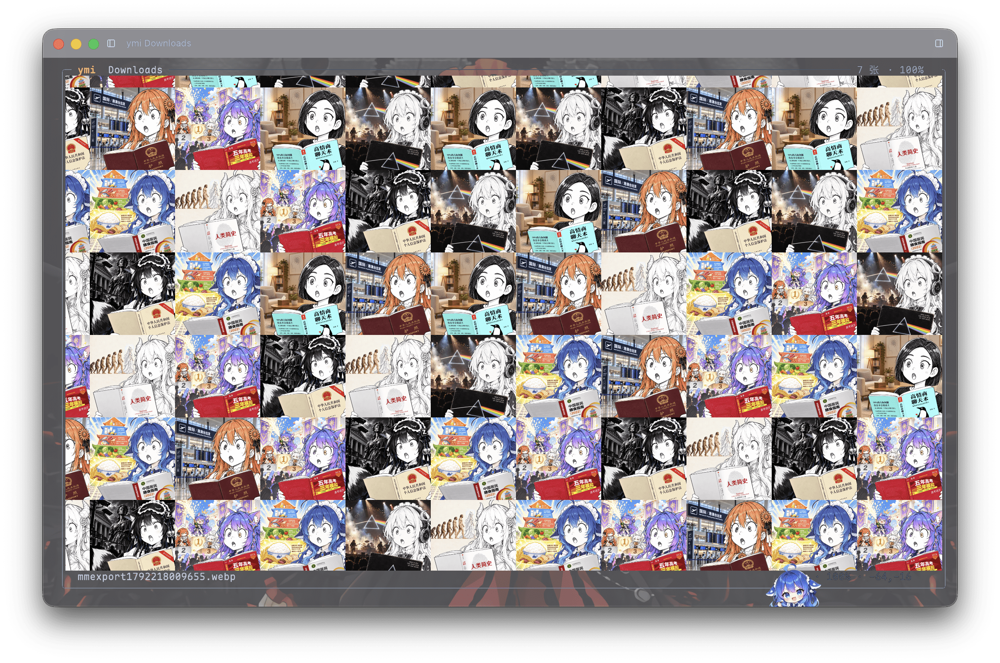

# ymi

macOS 终端里的无限画布，用于浏览本地图片。图片以位图形式交给终端保存，因此可以任意方向拖动；
界面与同系列工具一致：整窗自适应的圆角框、同一套配色、`Ctrl` 系快捷键。



上图是 `ymi ~/Downloads` 陆续加入 7 张图片后的样子：每张图铺成一个 1:1 方块，打散排布，
卡片之间没有缝隙；鼠标停在某张上时，状态栏显示它的文件名（图中底部那行）。

以下是同一界面的纯文本布局示意：

```
╭─ ymi  ~/Pictures ───────────────────────────────────────────────── 12 张 · 100% ─╮
│ ▒▒▒▒▒▒▒▒▒▒▒▒▒▒▒▒▒▒▒▒▒▒▒▒▒▒▒▒▒▒▒▒▒▒▒▒▒▒▒▒▒▒▒▒▒▒▒                                  │
│ ▒▒▒▒▒▒▒▒▒▒▒▒▒▒▒▒▒▒▒▒▒▒▒▒▒▒▒▒▒▒▒▒▒▒▒▒▒▒▒▒▒▒▒▒▒▒▒                                  │
│  拖拽平移 · 滚轮移动 · 点击查看 · a 选图 · x 删除 · ? 帮助                       │
╰──────────────────────────────────────────────────────────────────────────────────╯
```

## 关于这个项目

- **由 AI 生成**：代码与文档由 AI 助手根据使用者提出的需求编写，人工负责需求、取舍与测试。
- **仅适配 macOS**：开发和验证都在 macOS（Apple Silicon）上进行，其他平台未经测试，不保证可用。
- **不提供支持**：没有精力处理 issue 与 PR。遇到问题或有额外需求，请自行 fork、修改、构建。
- **按现状提供**：MIT 许可，不附带任何形式的担保。

## 功能

- 无限画布：任意方向拖拽平移，松手按手速继续滑一段
- 卡片为 1:1 方格，图片等比铺满并居中裁切，卡片之间不留缝隙
- 图片分布按 5×5 分块洗牌，小范围均匀、没有方向感，同一格子永远是同一张图
- 选图列表：递归搜索、输入即过滤、右侧实时预览、可连续加入
- 标签页：每个标签是独立画布，各自维护位置、缩放与图片列表
- 懒关闭：`Esc` 只关界面，画布留在后台；`Ctrl+Q` 连后台一起结束
- 不依赖外部程序：解码走 Rust 的 `image`，绘制走 Kitty 图形协议的共享内存传输
- 中英文界面可切换（`--lang`），提示、报错、帮助一并跟随

## 环境要求

需要支持 **Kitty 图形协议** 的终端（kitty、WezTerm、Ghostty、ELYTerminal 等）。`ymi --probe`
显示检测结果；不支持时程序直接退出，不会退化为字符画。

## 安装

需要 Rust 工具链（`rustup` 或 Homebrew 的 `rust`）。

```bash
cd ~/Desktop/ymi
./install.sh          # cargo build --release，装到 ~/.local/bin/ymi
```

`install.sh` 会构建 release、复制到 `~/.local/bin`、清除 macOS 加在二进制上的
`com.apple.provenance` 属性（不清除会被内核以 SIGKILL 终止）。

> 更换位置：`YMI_INSTALL_DIR=/usr/local/bin ./install.sh`。

## 用法

```bash
ymi                          # 空画布，每格一个 +
ymi ~/Pictures               # 指定目录：按 a 或 + 在该目录里递归找图
ymi ~/Pictures/a.jpg         # 直接铺上这张图：所有卡片都显示它
ymi --quit                   # 结束后台会话
```

- 不带目录时，`a` / `+` 用于输入路径（内置 Tab 补全）
- 带目录时，`a` / `+` 打开图片列表：输入即过滤，`Enter` 加入且列表不关闭，可连续添加，`Esc` 结束
- 给单张图片时，该图填入当前画布的所有卡片
- 添加第二张后，卡片按图片轮流分配；图片越多，重复感越弱。经列表选择不会重复添加，
  手动输入相同路径则可以重复

## 命令行参数

`ymi [OPTIONS] [TARGET]`

| 参数 | 取值 | 默认 | 作用 |
| --- | --- | --- | --- |
| `[TARGET]` | 目录或图片 | 空 | 给目录：画布 + 图片列表；给图片：这张图铺满所有卡片；不给：只有 `+` 卡片的空画布 |
| `--quit` | 开关 | — | 结束后台会话（`Esc` 只是关界面） |
| `--probe` | 开关 | — | 打印终端能力后退出，不进入界面 |
| `--lang <LANG>` | `cn` `en` | `cn` | 界面语言；单独使用时只写配置、不启动界面 |
| `-h` | | | 简洁说明，每个参数一行 |
| `--help` | | | 完整说明：取值、默认值、示例 |
| `-v` / `-V` | | | 一行版本号 |
| `--version` | | | 完整信息：构建目标、终端要求、许可 |

### 命令行约定

同系列四个工具（ymp / ymw / ymi / ymv）使用同一套约定：

| 写法 | 作用 |
| --- | --- |
| `-h` | 简洁说明，每个参数一行 |
| `--help` | 完整说明：取值、默认值、示例、退出码 |
| `-v` / `-V` | 一行版本号 |
| `--version` | 完整信息：构建目标、后端、终端要求、许可 |
| `--lang <LANG>` | 界面语言，`LANG` 取 `cn` 或 `en`。单独使用时只写入配置并退出，不启动界面；`--lang en`、`--lang=en`、`--language en` 等价，写错会报错 |

说明文字默认中文，`--lang en` 切换为英文，不混排。`--lang` 的值会校验：
写错（例如 `--lang xx`）直接报错并指出可选值，不会静默退回中文；带尖括号或引号
（`--lang <en>`、`--lang "en"`）会被自动去掉。

### 补充说明

- **`[TARGET]`**：`~` 由 shell 展开。目录会被递归扫描，图片按扩展名识别。
- **`--quit`**：后台无响应时的兜底；正常情况下 `Ctrl+Q` 就够了。
- **`--probe`**：排查「图不显示」的第一步，输出示例：

```
ymi 终端探测
  TERM              xterm-kitty
  TERM_PROGRAM      ELYTerminal
  kitty 键盘协议      是
  kitty 图形协议      是
  iterm2 内联图       否
  背景               深色
  单元格尺寸          16x31 px
```

## 配置

配置文件：`~/.config/ymi/config`（设置了 `XDG_CONFIG_HOME` 时改用 `$XDG_CONFIG_HOME/ymi/config`）。

```
# ymi preferences
lang = en
```

- 只切换语言、不启动界面：`ymi --lang en`。目录不存在会自动创建，写完后立即退出
- 不带 `--lang` 时读取该文件；文件不存在或没有 `lang` 项时使用中文
- `--lang` 与 `-h` / `--version` 同时出现时只影响本次输出，不写入文件
- 未知键会被忽略，旧版本读到新版本写的文件也不会报错

## 快捷键

| 键 | 作用 |
| --- | --- |
| 拖拽 | 任意方向平移，松开后按手速继续滑动 |
| 滚轮 / 左右滚 | 上下 / 左右移动，每格带缓停 |
| 点击 `+` | 选图（有目录时打开列表，否则输入路径） |
| 选图列表 | 左侧过滤，右侧预览当前选中项（终端足够宽时显示） |
| 鼠标悬停 | 状态栏显示图片文件名 |
| 点击图片 | 弹窗查看单张，宽度撑满，等比缩放 |
| `a` / `+` | 选图：有目录时翻列表（可连加），否则输入路径 |
| `x` / `Delete` | 删除指针下的图片（弹窗内同样有效） |
| `Ctrl + =` / `Ctrl + -` | 放大 / 缩小（以画面中心为锚点） |
| `Ctrl + 0` | 恢复 100% |
| `Ctrl + T` / `Ctrl + W` | 新建 / 关闭画布 |
| `Ctrl + 1~9`、`Ctrl + ←/→` | 切换画布 |
| `Esc` | 关闭弹窗；无弹窗时关闭界面（保留后台） |
| `Ctrl + Q` | 连同后台一起退出 |
| `?` | 帮助浮层 |

## 卡片排布

- 卡片在世界坐标中为 1:1 方格，向四个方向无限延伸
- 图片分布经过打散：平面切分为 5×5 的块，每块用自身的图组洗牌铺满，块与块之间再错开。
  同一格子始终对应同一张图（由哈希决定，平移与缩放不改变结果）
- 相邻卡片不会取到同一张图（块内会重新分配）
- 图片等比铺满卡片，超出部分居中裁切：横图裁两侧、竖图裁上下，仅影响显示，不修改原文件。
  因此卡片尺寸恒定，不随图片比例变化
- 卡片之间没有间距：图片均裁为方形，直接拼成连续网格。kitty 的尺寸与位置以整格为单位，
  一格在纵向即为单元格高度（常见为 31px），细缝无法表达，只能是 0 或一整格
- 卡片不绘制边框（边框会占满一整格，且横纵宽度不同）；空画布上每格仅显示一个 `+`
- 删除一张（`x` / `Delete`）后，所有卡片按新列表重排

排布按整格计算：卡片边长先折算为列数与行数，卡片位置为 `i × 步长 − 平移量`，全部为整数。
同一终端窗口内，所有卡片尺寸一致，平移不会累积误差。

卡片超出视口时按源图矩形裁切（kitty 协议的 `x,y,w,h`），不会压缩图片，也不会溢出到外框或状态栏。

## 后台会话

| 操作 | 结果 |
| --- | --- |
| `Esc` | 关闭界面，后台保留画布、标签页、位置与缩放 |
| `Ctrl+Q` | 连同后台一起结束 |
| 关闭终端窗口 | 后台检测到原终端消失（`POLLHUP`），自行退出并删除 socket |
| `ymi --quit` | 手动结束后台（后台无响应时的兜底） |

- 后台进程持有启动它的终端 fd，仅做 `poll` 不读取，不影响输入
- 再次运行 `ymi` 会 attach 到同一后台；`ymi <图片>` 将图片加到上次停留的画布
- 标签页（`Ctrl+T`）是独立画布，各自维护位置、缩放与图片列表

## 绘制方式

与 chafa 一次性转字符不同，图片以位图形式交由终端保存，因此可以拖动：

- 每张图只解码一次，缩放到卡片约两倍（约 420px），写入 POSIX 共享内存，
  通过 kitty 的 `a=t,f=24,t=s,S=<字节数>` 上传，此后像素由终端持有
- 平移与缩放只修改锚点：每张卡片对应一个 `a=p` placement，数十字节，不重传像素、不重新编码。
  镜头静止时不发送任何数据，事件循环不按固定帧率运行
- 卡片使用预先裁好的方形缩略图，不依赖终端实现源矩形裁剪
- placement 由 `(图片 id, placement id)` 唯一确定；移动为原地替换，离开视野时用
  `a=d,d=i,i=<图片>,p=<placement>` 精确删除。任一 id 缺失都会导致旧图层残留
- 惯性为速度指数平滑加 `v·e^(-k·dt)` 衰减；滚轮以冲量处理，总位移不变但会缓停
- 选图预览使用同一套 placement 机制；切换选中项后延迟 70ms 再解码，避免长按方向键时卡顿
- 仅解码视野内的卡片，离开视野即回收 placement；解码结果按 96MB 预算缓存
- 缩放超过 200% 会变模糊，因为缓存为卡片尺寸的 2 倍

### 画面与文字的层次

Kitty 协议默认把图画在文字**之上**，因此弹窗、列表这类浮层会被图片挡住。这里用 `z` 分层：

- 卡片以 `z=-1100000000` 放置。负值表示画在文字之下，而低于规范里的 `INT32_MIN / 2`
  还会落在**有非默认背景色的单元格**之下，于是面板用自己的实底就能遮住底下那一片。
- 弹窗自己的图片（选图预览、单图查看）用 `z=0`，留在面板底色上方，不会被自己的面板挡住。
- 面板以外的区域背景是默认色，画布照常透出、照常刷新——打开弹窗不需要撤掉画布，
  关闭也没有需要恢复的东西。

在 110×30 的终端中，一屏 12 张卡片，拖动时每帧终端流量约 1–2KB（均为锚点数据）。

## 已知限制

- 必须有 Kitty 图形协议，不支持时不启动，没有字符画降级
- 弹窗内的图片宽度撑满，高度受窗口限制，超长图会缩小
- 卡片为填满裁切，查看完整图片需点开弹窗
- 后台会话仅存活到原终端关闭；换一个终端窗口无法接续上次的会话
- 图片按扩展名识别：png / jpg / jpeg / webp / gif / bmp / tif / tiff / avif / jxl
- 终端未实现 `z` 负值分层时，弹窗会被画布图片盖住（见上一节）

## 排查

```bash
ymi --probe                        # 终端能力
ymi --quit                         # 结束后台会话
YMI_DEBUG=1 ymi                    # 后台日志写入 /tmp/ymi-daemon.log
YMI_SOCK=/tmp/ymi-test.sock ymi    # 使用独立的后台会话（调试或多开）
```

| 现象 | 含义 |
| --- | --- |
| 启动即退出，提示需要 kitty | 终端不支持图形协议或应答超时，用 `--probe` 查看 |
| 关闭界面后重新打开没有图片 | 后台已随终端关闭退出，或使用了不同的 `YMI_SOCK` |
| 需要同时开两套画布 | `YMI_SOCK=/tmp/ymi-b.sock ymi` |
| 图片边缘模糊 | 缩放超过 200%，缓存为卡片尺寸的 2 倍 |
| 弹窗被画布图片挡住 | 终端未实现 `z` 负值分层 |
| 卡片尺寸或间距不齐 | 同一张图的所有卡片尺寸相同；不同比例不会被拉伸，比例差异只影响裁切 |

## 实现

```
src/canvas.rs      世界坐标、卡片网格、图片分配
src/graphics.rs    kitty 上传 / placement 差分 / z 分层
src/shm.rs         POSIX 共享内存
src/app.rs         事件循环、命中测试、惯性、解码缓存
src/ui.rs          外框、空卡片、弹窗、选择器、帮助
src/cli.rs         参数定义、帮助与语言
src/i18n.rs        中英文文案
src/daemon.rs      后台会话（unix socket + 终端租约）
src/scan.rs        递归找图、过滤、Tab 补全
src/term.rs        终端能力探测
src/theme.rs       配色
```

## 分发

| 方式 | 命令 | 前提 |
| --- | --- | --- |
| 免编译包 | 解开 `ymi-<版本>-<arch>.tar.gz`，`cp ymi ~/.local/bin/`，再 `xattr -c` | 无 |
| crates.io | `cargo install ymi` | 已安装 Rust |
| 源码仓库 | `cargo install --git https://github.com/masakiyuizzz/ymi` | 已安装 Rust |
| 自行构建 | `./install.sh` | 已安装 Rust |

```bash
./release.sh        # -> dist/ymi-<版本>-<arch>.tar.gz（含 README、LICENSE、INSTALL.txt）
```

脚本只构建当前架构。为 Intel Mac 打包需在该架构上执行，或
`rustup target add x86_64-apple-darwin` 后交叉编译。

> 从浏览器下载的二进制带 quarantine 属性，直接执行会被系统终止（`Killed: 9`，退出码 137），
> 因此 `xattr -c` 是必需步骤。`install.sh` 与包内 `INSTALL.txt` 均已包含该步骤。

## 许可

MIT，见 [LICENSE](LICENSE)。
